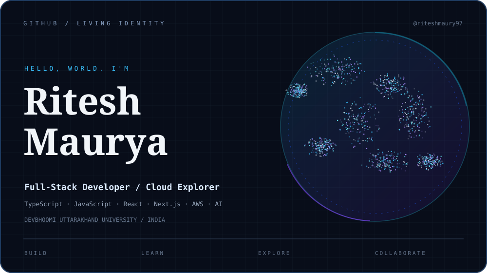

 <div align="center">



**Frontend / Full-Stack Developer · Cloud Enthusiast · Community Builder**

[Portfolio](https://riteshmaurya-phi.vercel.app/) · [GitHub](https://github.com/riteshmaury97) · [Repositories](https://github.com/riteshmaury97?tab=repositories)


</div>

---

## `01` / About Me

Hey! I'm **Ritesh Maurya**, a Computer Science and Engineering student at Dev Bhoomi Uttarakhand University, India.

I enjoy building digital products, exploring emerging technologies, and turning ideas into practical solutions.

- 🎓 B.Tech Computer Science & Engineering
- 💻 Full-Stack Web Development
- ☁️ AWS & Cloud Computing
- 🤖 Generative AI & Agentic AI
- 🚀 Developer Communities & Open Source
- 🛠️ Building real-world applications

```typescript
const ritesh = {
  role: "Developer & Tech Enthusiast",
  education: "B.Tech CSE @ DBUU",
  interests: ["Full-Stack", "Cloud", "AI", "DevOps"],
  currentlyLearning: ["Agentic AI", "AWS", "System Design"],
  philosophy: "Learn continuously. Build meaningfully."
};
```

## `02` / Technology Stack

**Languages**


**Frontend**


**Backend & Databases**


**Cloud & Developer Tools**


## `03` / Selected Projects

| Project | Description | Technologies |
|---|---|---|
| Satyam International School | Modern school website and digital management ecosystem | Next.js, Firebase, TypeScript |
| DesignVault | Personal design-resource management platform | Next.js, Firebase |
| SiS Voting | Secure institutional voting platform | Next.js, Firebase, TypeScript |
 
[Explore all my repositories →](https://github.com/riteshmaury97?tab=repositories)

## `04` / Community & Achievements

- ☁️ AWS Student Builder – DBUU
- 🌐 Google developer community and campus technology initiatives
- 🚀 Campus ambassador and student engagement initiatives
- 💡 Innovators Club activities
- 🎓 Hosted an IBM SkillsBuild introduction session with 90 participants
- 🤖 Exploring hands-on Agentic AI development

## `05` / GitHub Statistics

<div align="center">


</div>

## `06` / Contribution Activity

<div align="center">


</div>

## `07` / Current Mission

```text
[01] Building production-ready web applications
[02] Exploring AWS and cloud architecture
[03] Experimenting with Agentic AI
[04] Improving software engineering skills
[05] Contributing to developer communities
```

## `08` / Let's Connect

<div align="center">

<a href="https://riteshmaurya-phi.vercel.app/">

</a>
<a href="https://github.com/riteshmaury97">

</a>

</div>

---

<div align="center">

**BUILD SOMETHING MEANINGFUL.**

`DESIGN` / `DEVELOP` / `DEPLOY` / `REPEAT`


</div>
