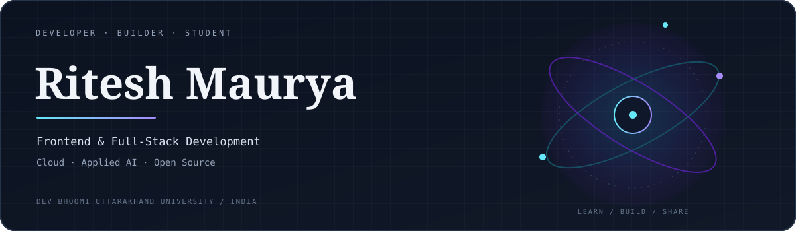
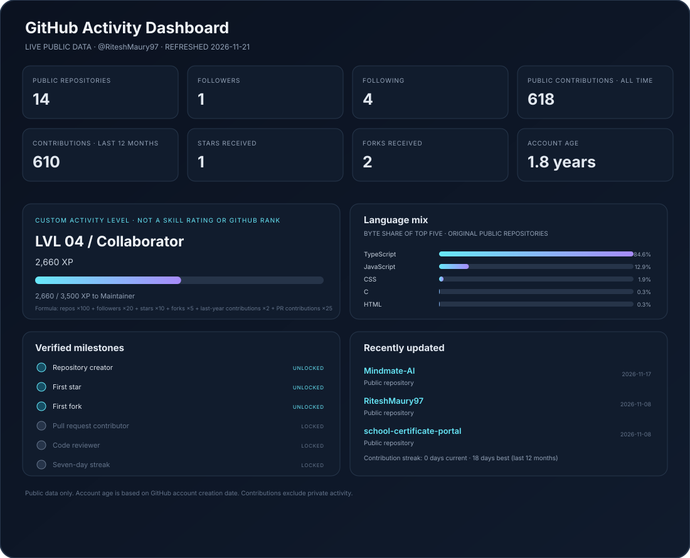
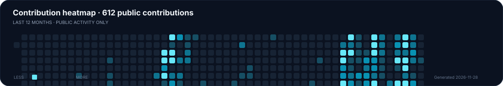

<div align="center">



### Frontend & Full-Stack Development / Cloud / Applied AI

Building useful web experiences and learning in public from India.

[Portfolio](https://riteshmaurya-phi.vercel.app/) / [LinkedIn](https://www.linkedin.com/in/riteshmaury97/) / [Projects](https://github.com/RiteshMaury97?tab=repositories)

</div>

---

## A little about me

I'm **Ritesh Maurya**, a Computer Science and Engineering student at **Dev Bhoomi Uttarakhand University**. I enjoy taking ideas from interface to implementation, with a growing focus on cloud platforms and AI-powered products.

- Studying B.Tech in Computer Science & Engineering
- Building with JavaScript, TypeScript, React, and Next.js
- Exploring AWS, backend development, and agentic AI
- Interested in open source, developer communities, and practical products

## Selected work

| Project | What it is | Explore |
| --- | --- | --- |
| **Finance Navigator** | A finance project exploring how AI can support money management and saving decisions. | [Repository](https://github.com/RiteshMaury97/Finance-Navigator) |
| **Mindmate** | A project in my public portfolio; visit the repository for its current scope and implementation. | [Repository](https://github.com/RiteshMaury97/Mindmate) |
| **My Personal Portfolio** | My portfolio site and a home for selected work. | [Repository](https://github.com/RiteshMaury97/My-Personal-Portfolio) / [Live site](https://riteshmaurya-phi.vercel.app/) |

[Browse all repositories](https://github.com/RiteshMaury97?tab=repositories)

## Tools I use

<p>
  
</p>

## Community

- AWS Student Builder at DBUU; AWS Student Builder Community Leader
- Google Student Ambassador
- IIT Delhi Techfest Ambassador
- Hosted an IBM SkillsBuild introduction session for 90 participants
- Involved in campus technology initiatives and Innovators Club activities

## Currently learning

`AWS & cloud architecture` / `Agentic AI` / `System design` / `Production-ready application development`

## GitHub Analytics Dashboard

<div align="center">





</div>

### Developer Arcade

GitHub README files cannot run JavaScript or track game state, so these are static challenges with answer reveals.

**GitHub Snake Challenge**

<div align="center">


</div>

*Fallback: [open my contribution activity on GitHub](https://github.com/RiteshMaury97#contributions-calendar).*

**Developer Quiz** - What does `typeof NaN` return in JavaScript?

<details>
<summary>Reveal answer and scoring</summary>

It returns `"number"`. Give yourself 1 point if you knew it before opening the answer.

</details>

**Terminal Challenge** - Predict the output:

```text
>>> 2 ** 3 ** 2
512
```

Python exponentiation is right-associative, so this evaluates to `2 ** (3 ** 2)`.

**Daily Coding Challenge** - [Try a problem on LeetCode](https://leetcode.com/problemset/).

### Milestones & learning

- **Verified activity:** public repositories, stars, forks, pull requests, reviews, and contribution streaks appear as unlocked only when the GitHub API reports them.
- **Community experience:** AWS Student Builder, Google Student Ambassador, IIT Delhi Techfest Ambassador, and an IBM SkillsBuild session hosted for 90 participants.
- **Learning interests:** AWS and cloud architecture, agentic AI, and system design. These are interests, not earned badges.

The custom XP score is a reproducible activity measure, not an official GitHub ranking or a measure of engineering skill. The exact formula and thresholds are documented in [the dashboard setup guide](.github/profile-dashboard.md).

## Find me

[](https://riteshmaurya-phi.vercel.app/)
[](https://www.linkedin.com/in/riteshmaury97/)
[](https://www.instagram.com/rm_mau_rya/)
[](https://github.com/RiteshMaury97)

<div align="center">

*Learn continuously. Build meaningfully.*

</div>
